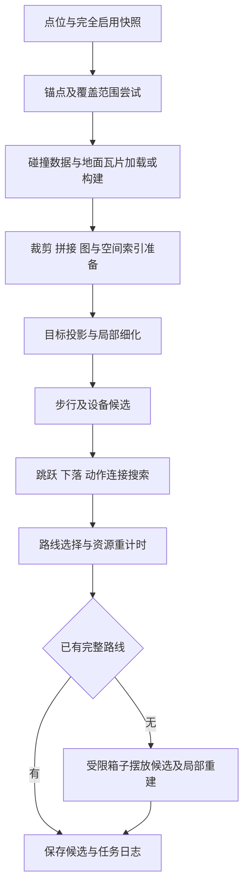

# Handoff01 寻路实现现状与目标差距

调查日期为 2026-11-09。本文件依据当前源码、仓库状态及留存验证记录编写。本轮进行了静态调查和证据核对，未重新执行求解、浏览器验收或性能回放。表中的测量值均标注对应历史版本。

## 1. 当前工作区与责任边界

| 仓库或组件 | 调查时版本 | 状态与职责 |
| --- | --- | --- |
| Ganglia | `main` / `a9507ae`，`0.1.0-alpha.59` | 调查前工作树干净，领先本地 `origin/main` 跟踪引用 6 个提交。负责支撑面、定向通道、碰撞、运动与搜索 |
| Atlos | `feat/3d-preview` / `c7a28dca` | 工作树干净，与本地远端跟踪引用一致。负责上游集成、数据导出、任务调度、预览及日志 |
| endfield-noclip | `trunk` / `30f73f46` | 工作树干净，与本地 `upstream/trunk` 跟踪引用一致。作为上游来源 |
| AKEDataMining | `ae33f49ff` | 当前 Lua 行为参考来源 |
| Atlos noclip 集成 | packageVersion `98` | 固定上游 `30f73f4609b24f033e3e2a48607d3270b01695a3`，叠加四份补丁 |

上述远端关系来自本地跟踪引用，本轮未重新 fetch。Atlos `talos/integrations/noclip/` 是定制源码的维护入口，包含 `extractor.patch`、`renderer.patch`、`format.patch`、`documentation.patch`。`talos/.cache/noclip/` 是生成目录，可用于阅读和验证，修改必须回到补丁维护流程。继续同步上游时应保留这个边界。

最近两项 Atlos 成果为 `fef4898c` 的叉车、受限活动范围箱子建模，以及 `c7a28dca` 的 3D 预览和寻路入口恢复。普通预览受资源配置约束，寻路入口仍沿用开发模式条件。[集成配置](../../Atlos/talos/integrations/noclip/source.json)

## 2. 当前采用的需求与模型范围

- 默认任务完成、设施启用并供电、门打开。几何支撑、净空、碰撞以及有效危险区仍参与检查。
- 移动石头、荷叶、传送带箱子、电梯和 seesaw 使用用户认可的无相位模型。水平运动主要提供扫掠支撑，垂直运动提供运输连接。
- 叉车覆盖四号谷地和武陵，使用实际升降货架子树及控制姿态。
- 随行垫脚箱按活动范围内可安排位置的假设建模。求解给出所需摆放位置，省略激活和引导过程，搬动时间未计入路线成本。
- 预览在实际使用位置画支撑矩形，复用现有覆盖层。最新建模批次遵循用户要求，端到端验收暂缓。

architecture 中的已知相位、未知相位策略、等待时间和控制回放仍是长期目标。当前无相位方案具有明确的用户授权，应在结果语义和后续验收中持续保留这一假设。[当前装置模型记录](../../Atlos/talos/apps/world/docs/route-inspection.md#controlled-supports)

## 3. 一次查询实际经历的流程

具体尝试会穿插设备预检、扩大覆盖和已有候选保留，图中表达数据依赖。任务总延迟包括多个锚点和覆盖尝试、排队、构建及子进程启动，单个 `player-route` 命令时间只覆盖其中一段。

地面来自真实碰撞三角形，经 Recast WASM 的体素化、净空筛选、合法相邻高度连接、半径侵蚀、区域及轮廓生成得到。当前导出细节三角形为 `Surface`，原生导航多边形与细节三角形的所有权关系未保留。后续精细图规模因此随细节密度增长。落脚点通常在已有支撑上投影采样，跳跃还需要轨迹、滞空时间和连续碰撞验证。[表面实现](../src/support-field.mjs) [现有资产流程](prebuilt-navigation.md)

## 4. 对照 roadmap 与 architecture

两个主文档保留 alpha.21 时期的建模基线。architecture 后续更新了工作区边界，阶段完成情况应结合当前实现与专项验证记录读取。

| 目标阶段 | 当前实现和证据 | 距离验收的差距 |
| --- | --- | --- |
| G0–G2 地面语义与资产 | compact-span 楼梯连接、成对入口/出口区间、定向台阶检查、局部细化、接缝与负例测试已实现 | 验证覆盖限定于记录中的参数族和样本。细节面仍承担搜索节点，区域与细节所有权需完善 |
| G3 共享层次结构 | 已有连通分量预检查、准备数据和局部查询复用 | 缺少持久化区域入口/出口 transfer、状态保持的走廊收缩，以及压缩图对精细参考图的等价验收 |
| G4 产品接入 | 物理瓦片缓存、日志、临时候选、覆盖与起点尝试已接入普通入口 | 新目标仍有大量图准备和动作发现。完整任务的冷启动与首次可行解预算需统一验收 |
| G5 / P2 统一资源状态动作图 | 地面、跳跃、下落、设备连接可以组合，路线资源调度已有实现 | 基础图仍按节点保留单一最小代价。尚缺完整资源状态多标签搜索及跨动作实际出口连续性 |
| M0–M2 / I0 前向语义及参考求解器 | 查询契约、动作结构、解析轨迹与碰撞能力已有基础 | 独立的控制前向回放、误差传播和推荐可靠性判定尚不完整 |
| M3 解的界与截断语义 | 有候选预算、截断诊断、可行候选保留和部分乐观连通检查 | 尚缺完整资源参考模型、明确的最优性间隙及未知动作工作量的质量界 |
| M4 / I1 离线共享 | 已有内容绑定的地面瓦片和物理输入缓存 | 缺少可加载的区域拓扑/动作资产、局部变更失效传播及完整场景构建发布验收 |
| P3 / I2 静态设备 | 滑索、弹跳装置有来源、连接、运动时间及碰撞检查 | 空中命中与安全结束语义、统一资源和控制证据还需补齐 |
| P4 / I2 动态设备 | 扫掠支撑、垂直运输、seesaw、叉车和箱子摆放已接入 | 当前按无相位模型验收。完整时间窗、等待和可控楼层模型尚未实现 |
| P1 / P5 路线质量与鲁棒性 | 有局部捷径、候选比较和资源重计时 | 全路线扰动回放、最快/推荐双目标、稳定可执行动作族尚缺完整实现 |
| P6 / I3 性能发布 | 有多轮热路径优化、逐点冻结输入对比和小型 WASM 实验 | 用户要求的首次搜索降至原用时约 10% 尚未达成，当前最新批次缺少同版本全链路性能证据 |

基础搜索的 `costs` 按节点保存一个值。`retimeGroundRoute` 对已选路线进行资源标签调度，这种调度无法替代在全图中保留不同资源状态的可行路径。下一轮需要保留“更快但资源不足的连接加入后，原有可行解仍能找到”等参考反例。[基础搜索](../src/routes.mjs) [资源调度](../src/locomotion.mjs) [阶段验收定义](architecture.md#9-model-first-development-phases)

## 5. 最新装置批次的实现边界

| 类型 | 已实现 | 已有验证与剩余边界 |
| --- | --- | --- |
| 固定滑索、弹跳装置 | 数据驱动端点、设备参数与动作连接 | 有定向性、遮挡、支撑和完全启用快照测试 |
| 浮石、荷叶、传送带箱子、电梯 | 无相位扫掠支撑与运输连接 | 有真实局部支撑采样记录。无相位路线仍需按这一假设解释 |
| seesaw | 已纳入移动支撑导出与模型 | 角运动时间与相位未完成 |
| 常开蒸汽 | 作为通行排除参与当前移动支撑规划 | 本次未重新逐项核对全地图危险源覆盖 |
| 叉车 | 实际货架几何和两端控制姿态，车体保留静态碰撞 | map01 18 个、map02 5 个，有数据审计和合成测试。真实点位及渲染验收待做 |
| 随行箱 | authored 活动球内采样，落地支撑及碰撞检查，重建实际箱顶，输出使用位置 | map01 23 个、map02 9 个。有合成测试，真实点位验收待做 |

箱子求解有几个直接影响覆盖和时间的边界。

1. 当前仅在已有求解未得到完整路线时调用，因此能够补充可达性，已有绕远路线的箱子捷径比较仍待实现。
2. 每次试验移动一个来源箱子，其余箱子保留原始碰撞。协调多箱摆放仍待支持。
3. 候选受有限预算约束，当前命令默认 `maxCandidates=8000`、`maxLinks=64`。活动范围内连续位置覆盖尚无完备性保证。
4. 几何支持以水平箱顶和可处理的 BoxCollider 为主，无法确认原始碰撞归属或不支持的几何会输出诊断。
5. 候选摆放引入几何变化与局部重建，必须单独计时，避免新 fallback 成为新的长尾。

维护入口为 `extractor.patch`。对应生成源码的主要模块为 `game/following-route.ts`、`following-supports.ts`、`forklift-supports.ts`、`moving-ground.ts` 和 `commands/player-route.ts`。[实现补丁](../../Atlos/talos/integrations/noclip/extractor.patch)

## 6. 验证证据及其适用范围

### 地面和历史成功集

- alpha.22 的楼梯参数族记录 24 个定向查询全部仅步行完成，包含多个踏面深度、旋转和双向通行。真实固定正例记录为 31/31，含 13 个台阶剖面样本。
- alpha.58 的 38 个冻结物理输入全部保持完整结果及所选代价，37 个路线对象、36 个全部动作集合完全一致。
- 冻结输入来自 v74 升级前。alpha.59 加当前数据及最新箱子、叉车批次的全部成功点回归尚未验证。
- 十个冻结基线点仍有更短历史留存路线。保持冻结基线仅证明该对照下未变差，历史最优差距仍需解决。

详见[楼梯验证](stairs-validation.md)和[完整逐点表](per-point-performance.md)。

### 代表点历史记录

| 点位或案例 | 版本/输入 | 求解耗时 | 模型行程 | 结论及限制 |
| --- | --- | ---: | ---: | --- |
| `10YLgUg` | alpha.58 冻结输入 | 9.975 s | 8.199 s | 完整，冻结代价保持。历史留存 6.154 s |
| `17nac6U` | alpha.58 冻结输入 | 19.262 s | 22.634 s | 完整，冻结代价保持。历史留存 15.238 s |
| `0bzZEM3` | alpha.58 冻结输入 | 35.092 s | 50.812 s | 完整。尚不能代表当前数据全链路首次延迟 |
| `0nQJhsI` | alpha.58 冻结输入 | 20.122 s | 32.514 s | 完整，冻结代价保持 |
| `0DUKUgc` | 截至 11-05 的留存审计 | 完整搜索命令 46.526–165.917 s | — | 17 个留存结果均 unavailable，6 个完整搜索均截断。最新版本状态待确认 |
| `02lUaTb`，map02_lv009 | 移动支撑集成留存输入 | 51.90 s | 55.686 s | 完整，锚点距离 184.83 m，2 次滑索、7 次跳跃。未使用移动扫掠面 |
| 荷叶端部任意目标 | 移动支撑集成留存输入 | 25.12 s | 33.170 s | 完整，583 个步行采样中 74 个仅由移动面支撑 |
| `0YnbG6f` | 小覆盖高爬升输入 | 52.51 s，设备准备 12.61 s | — | unavailable。大覆盖还曾暴露原生垂直范围与 JSON 大小限制 |
| `0DPyejn`、`0T264e6`、`0mmXi4a` | 用户问题集 | 本轮未重测 | — | 当前可达性、必要装置或锚点质量待建立同版本记录 |

这些时间均摘自留存记录。`02lUaTb` 的成功证明远距离混合动作可解，尚未证明该案例必须依靠移动装置。荷叶案例提供扫掠支撑使用证据，map02_lv009/010 远点的系统覆盖验收仍待完成。[装置验证记录](../../Atlos/talos/apps/world/docs/route-inspection.md#moving-support-verification)

### 最新导出与合成检查

本轮读取 `/tmp/placement-final-tests.log`，记录 65 个测试通过、0 失败。读取 `/tmp/placement-export-audit.json`，map01 移动支撑由 87 增至 105，map02 由 139 增至 144，原有共 226 个移动支撑对象及其他目录字段保持一致。该批增加 23 个叉车与 32 个随行箱来源。

临时日志是本机留存证据，持久概要位于 Atlos `route-inspection.md`。后续发布验收应将可复现输入身份和原始结果纳入持久记录。当前证据支持导出兼容与受测合成行为，真实地图寻路、端到端时延和 GPU 矩形显示仍待验收。

## 7. 性能目标距离与结构性成本

alpha.53 的 38 点命令总计为 398.647 s，alpha.58 为 463.199 s。记录明确这些轮次未交错、未隔离负载，不能据总和判断稳定提速或退步。原始网格构建、多个起点尝试和 HTTP 调度另计。当前证据尚未达到用户提出的约 90% 时间削减目标。[性能记录](solver-performance.md)

源码和留存 profile 指向以下成本。

| 成本 | 已有优化 | 下一层缺口 |
| --- | --- | --- |
| 原始支撑面构建 | WASM Recast、内容指纹瓦片缓存、高度空隙分区 | 版本升级及新覆盖仍需构建，完整离线清单尚缺 |
| 图和索引准备 | 准备数据复用、目标距离缓存、连通预检查 | 细节三角形驱动图规模，新增少量细化面仍可能引发大范围准备 |
| 设备端点比较 | 不同弱连通分量提前拒绝、成功 trace 复用 | 大区域设备连接仍依赖精细图，缺少区域 transfer |
| 跳跃及下落 | 检索、局部复用、预算及已有候选保留 | 缺少可跨查询加载、带验证适用域的动作资产 |
| 多起点/多覆盖 | 调度尝试与日志已有实现 | 命令时间与完整任务延迟需统一，重叠准备及失败尝试成本需逐阶段归因 |
| 箱子摆放 | 有限候选与明确失败原因 | 候选局部重建成本和新增可达性尚缺真实数据对照 |

预构建已有体积实验。`0bzZEM3` 局部输入的几何、图、普通通道和 BVH 实验负载为原始 60.10 MiB、gzip 16.70 MiB，缺少完整 manifest、碰撞 BVH 和动作证据等内容。全场景体积只有外推，生产加载格式与完整离线包尚未交付。

C/WASM BVH 原型的内核构建中位数由 151.8 ms 降至 86.1 ms，计入初始化、打包和 JS 重建后为 138.2 ms。该组件试验尚未进入完整路线验收。下一轮应先减少需要准备和搜索的数据规模，再据 profile 决定连续数组内核迁移范围。[预构建与 WASM 实验](prebuilt-navigation.md)

## 8. 建议交接顺序与完成条件

### 第一阶段 固定当前验收契约

记录数据构建、SDK、集成补丁摘要、快照、角色参数、目标语义、锚点集合与预算。保留旧 38 点冻结套件，并为当前数据建立新记录。将历史较短路线和未解决点同时列入质量清单。最新装置批次继续注明端到端待验收，执行时遵循用户后续授权范围。

完成条件为每条结论能追溯输入身份，超时、预算耗尽、缺失支撑、设备未覆盖和模型内不可达具有可区分的诊断。

### 第二阶段 推进 G3 与 I1 的区域资产

先保留导航多边形、细节高度和定向 portal 所有权，建立分区加载接口。再构建区域入口/出口的定向 transfer，按目标所需区域读取细节碰撞和支撑。共享资产需绑定几何、快照、角色和运动模型，并支持局部失效。

完成条件为小型可穷举模型中压缩与精细搜索在可达性、方向和声明代价上相符，覆盖楼梯、叠层、单向下落和设备捷径。之后才扩大真实区域。测量应同时包含首次冷启动、新目标复用、扩大覆盖和峰值内存。

### 第三阶段 补齐 I0 资源参考求解器

以有限状态参考图保存会影响后继的资源维度，明确支配条件。保留较慢但资源可行的路线，并用实际动作出口连接后续入口。逐步接入独立前向验证与终止事件检查。

完成条件为 architecture 中资源反例和跨动作连续性反例有可复现结果，并可作为后续剪枝的比较基准。

### 第四阶段 扩大装置覆盖和路线质量

先确认当前摆放、升降和扫掠模型在普通调用入口中的覆盖。随后比较已有完整路线与箱子捷径，扩展必要的多箱配置。规划结果持续输出所用假设、实际摆放位置与未计成本。相位精确化待用户需求变化后再按 architecture 的动态机制目标推进。

完成条件为 map02_lv009/010 的代表远点明确记录是否真正依赖移动支撑，叉车和随行箱有相同输入下的启用/移除对照，并保持成功集的可达性和路线代价。

### 第五阶段 性能发布

逐点报告完整任务首次可行时间、最终完成时间、构建、图准备、碰撞、设备、动作发现、搜索、摆放 fallback 及峰值内存。相同输入和预算下交错测量，报告失败和截断。是否达到原用时约 10% 应以预先固定的完整任务基线判断。

## 9. 接手时优先阅读

1. [architecture](architecture.md) 的 I0、I1 和第 6–8 节。
2. [ground-topology](ground-topology.md) 的 G3–G5 验收及 [stairs-validation](stairs-validation.md) 的已测覆盖。
3. [solver-performance](solver-performance.md)、[逐点表](per-point-performance.md)、[预构建资产](prebuilt-navigation.md)。
4. Ganglia `src/routes.mjs`、`ground.mjs`、`support-field.mjs`、`jump-planner.mjs`、`locomotion.mjs`。
5. Atlos `talos/apps/world/physical-route-builder.ts` 和 `talos/integrations/noclip/`，再查看生成的 `player-route.ts`、`moving-ground.ts`、`following-route.ts`。

本次交接文档未宣告新的可达点或新的性能收益。当前最明确的结构性工作是区域拓扑与动作资产，以及完整资源状态参考求解器。装置覆盖的新增实现已有独立进展，仍需在上述共同契约下完成验收。
